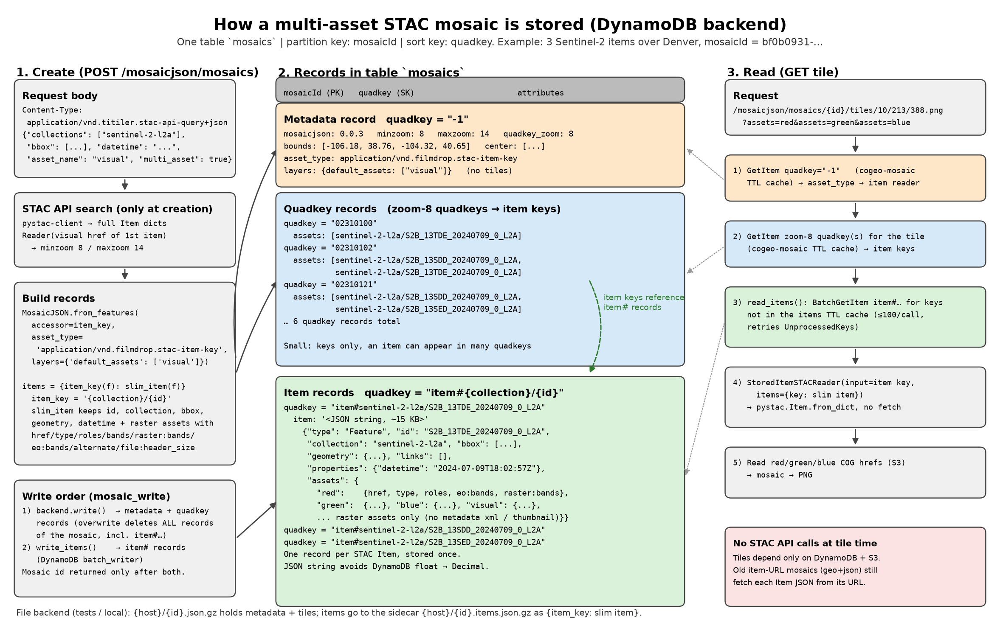

# Mosaics

The `/mosaicjson/mosaics` endpoints create a mosaic once, store it, and then
serve map tiles from it by ID. A mosaic is a [MosaicJSON](https://github.com/developmentseed/mosaicjson-spec)
document: an index from zoom-level quadkeys to the datasets that cover them.

There are two kinds of mosaic:

| Kind | Created from | Each quadkey lists | Tiles read with |
| --- | --- | --- | --- |
| Single asset | COG URLs, a MosaicJSON body, or a STAC API query | COG hrefs | `rio_tiler.io.Reader` |
| Multi asset | A STAC API query with `"multi_asset": true` | STAC Item keys (`{collection}/{id}`) | `StoredItemSTACReader` |

A multi-asset mosaic can render any of its items' assets at tile time, so one
mosaic can serve true color, false color, a single band, etc.

## Endpoints

| Method | Path | Description |
| --- | --- | --- |
| `POST` | `/mosaicjson/mosaics` | Create a mosaic; returns its ID and links (`Location` header points at it) |
| `GET` | `/mosaicjson/mosaics/{id}` | Mosaic resource with links |
| `GET` | `/mosaicjson/mosaics/{id}/mosaicjson` | Stored MosaicJSON document |
| `GET` | `/mosaicjson/mosaics/{id}/tilejson.json` | TileJSON (default `tilesize=512`) |
| `GET` | `/mosaicjson/mosaics/{id}/tiles/{z}/{x}/{y}[.{format}]` | Map tile (WebMercatorQuad, default `tilesize=256`) |
| `GET` | `/mosaicjson/mosaics/{id}/WMTSCapabilities.xml` | OGC WMTS capabilities |

Query parameters given to `tilejson.json` and `WMTSCapabilities.xml` (for
example `assets`, `rescale`, `colormap_name`) are copied into their tile URLs.

## Creating a mosaic

`POST /mosaicjson/mosaics`; the `Content-Type` header selects the body format.

### From a STAC API query

`Content-Type: application/vnd.titiler.stac-api-query+json`

```bash
curl -X POST http://localhost:8000/mosaicjson/mosaics \
  -H 'content-type: application/vnd.titiler.stac-api-query+json' \
  -d '{
    "stac_api_root": "https://earth-search.aws.element84.com/v2",
    "collections": ["sentinel-2-l2a"],
    "bbox": [-105.1, 39.6, -104.9, 39.8],
    "datetime": "2026-09-27T00:00:00Z/2026-09-28T00:00:00Z",
    "query": {"eo:cloud_cover": {"lt": 20}},
    "asset_name": "visual",
    "multi_asset": true,
    "max_items": 50
  }'
```

| Field | Description |
| --- | --- |
| `stac_api_root` | STAC API to search (required) |
| `collections`, `ids`, `bbox`, `intersects`, `datetime`, `query`, `filter` | Standard STAC API search parameters. A single `datetime` value is treated as an end date |
| `max_items` | Maximum items to include; capped at 1000 |
| `limit` | STAC API page size (default 100) |
| `asset_name` | Asset used for zoom levels (read from the first item) and, for single-asset mosaics, the asset that is mosaicked. Defaults to `visual` |
| `multi_asset` | Store the items so tiles can choose assets (see below). Default `false` |
| `name`, `description`, `attribution`, `version` | MosaicJSON metadata |

Items must have `Polygon` geometries; `MultiPolygon` items are rejected.

### From COG URLs

`Content-Type: application/vnd.titiler.urls+json`

```json
{"urls": ["s3://bucket/a.tif", "s3://bucket/b.tif"], "minzoom": 8, "maxzoom": 14}
```

Up to 1000 URLs. Each COG is opened to compute its footprint.

### From a MosaicJSON document

`Content-Type: application/json` or `application/vnd.titiler.mosaicjson+json`,
with a MosaicJSON body. MosaicJSON whose `asset_type` is
`application/geo+json` and whose tiles list STAC Item URLs is also accepted; the
Items are then fetched from those URLs at tile time. Bodies with
`asset_type: application/vnd.filmdrop.stac-item-key` are rejected because the
items they reference can only be created from a STAC API query.

## Requesting tiles

All TiTiler dataset, rendering and colormap parameters are supported
(`rescale`, `color_formula`, `colormap_name`, `colormap`, `resampling`,
`nodata`, `unscale`, `expression`, ...). Layer selection depends on the kind of
mosaic:

| Parameter | Single-asset mosaic | Multi-asset mosaic |
| --- | --- | --- |
| `bidx` | Band indexes | `400`; use `assets={name}\|bidx=...` |
| `assets` | `400` | Asset names, repeatable. Defaults to `asset_name` from creation |
| `asset_as_band` | `400` | Treat each asset as a single band |
| `expression` | Band math over `b1`, `b2`, ... | Band math over the bands of the selected `assets`, in order |

Assets accept per-asset options (titiler 2 syntax):
`assets=visual|bidx=1,2,3`, `assets=red|bidx=1`, `assets=nir|expression=b1*2`.

```bash
ID=<mosaic id>
# default asset (visual)
curl -o tile.png "http://localhost:8000/mosaicjson/mosaics/$ID/tiles/10/213/388.png"
# true color from the 10 m bands, in reflectance
curl -o tile.png "http://localhost:8000/mosaicjson/mosaics/$ID/tiles/10/213/388.png?assets=red&assets=green&assets=blue&unscale=true&rescale=0,0.3"
# NDVI
curl -o tile.png "http://localhost:8000/mosaicjson/mosaics/$ID/tiles/10/213/388.png?assets=nir&assets=red&expression=(b1-b2)/(b1%2Bb2)&rescale=-1,1&colormap_name=rdylgn"
# TileJSON for a map client, carrying the same render parameters
curl "http://localhost:8000/mosaicjson/mosaics/$ID/tilejson.json?assets=red&assets=green&assets=blue&unscale=true&rescale=0,0.3"
```

Tiles with no imagery return `204 No Content`. Overlapping datasets are combined
by taking the first valid pixel, in the order they are stored for the quadkey.

### Scale and offset (`unscale`)

Many COGs store scaled integers and record the conversion only in STAC (for
Sentinel-2 L2A: `value * 0.0001 - 0.1`). Without `unscale`, tiles use the stored
integers, so `rescale` must be in those units (e.g. `0,3000`).

With `unscale=true` on a multi-asset mosaic, each asset's STAC scale and offset
are applied before `expression` and `rescale`, so values are in physical units:

```bash
curl -o tile.png "http://localhost:8000/mosaicjson/mosaics/$ID/tiles/10/213/388.png?assets=red&assets=green&assets=blue&unscale=true&rescale=0,0.3"
```

- Read from asset `raster:scale`/`raster:offset` (STAC 1.1), per-band
  `bands[].raster:scale`/`raster:offset` (STAC 1.1), or `raster:bands[].scale`/
  `offset` (STAC 1.0). Missing values default to scale `1`, offset `0`.
- If the COG itself has a GDAL scale/offset, that is used instead of STAC.
- STAC `nodata` (asset or first band) is used for masking when the COG has no
  nodata and the request does not set `nodata`.
- Output is `float32`. Mosaics created before scale, offset and nodata were
  stored (STAC 1.1 asset-level fields) must be recreated to use them.

## How multi-asset mosaics are stored



At creation the STAC API is searched once. Each Item is reduced to what the
reader needs (`id`, `collection`, `bbox`, `geometry`, datetime properties, and
raster assets with `href`, `type`, `roles`, `bands`, `raster:bands`,
`eo:bands`, `alternate`, `file:header_size`, `raster:scale`, `raster:offset`,
`nodata`) and stored with the mosaic. Tile
requests read only those stored records and the COGs; they never call the STAC
API, so tiles keep working if the STAC API is slow, rate limited, or changes.

### DynamoDB backend

All records live in one table (partition key `mosaicId`, sort key `quadkey`):

| `quadkey` | Record | Contents |
| --- | --- | --- |
| `-1` | Metadata | Bounds, center, zooms, `quadkey_zoom`, `asset_type`, `layers.default_assets` |
| e.g. `02310102` | Quadkey | `assets`: item keys covering that quadkey |
| `item#{collection}/{id}` | Item | `item`: the slimmed Item as a JSON string (~7 KB for Earth Search v2 Sentinel-2) |

Each Item is stored once, however many quadkeys it covers. It is stored as a
JSON string so floats are not converted to DynamoDB `Decimal`s.

The metadata and quadkey records are written first, then the Item records. The
mosaic ID is returned only after both writes succeed.

### File backend

`{host}/{id}.json.gz` holds the MosaicJSON; Items go to the sidecar
`{host}/{id}.items.json.gz` as `{item_key: item}`. This backend is used by the
tests. Other backends (for example S3) are not supported for multi-asset
mosaics.

### Reading a tile

1. Read the metadata record (cached) to find the `asset_type` and default assets.
2. Read the quadkey records covering the tile (cached) to get the item keys.
3. Fetch any Items not already cached with DynamoDB `BatchGetItem`
   (100 keys per call, retrying unprocessed keys).
4. Build a `StoredItemSTACReader` per Item from the stored dict and read the
   requested assets' COGs.
5. Mosaic the Items and render the image.

## Configuration

| Variable | Default | Description |
| --- | --- | --- |
| `TITILER_API_DISABLE_MOSAIC` | `false` | Disable the mosaic endpoints |
| `TITILER_API_MOSAIC_BACKEND` | `file://` | `dynamodb://` or `file://` |
| `TITILER_API_MOSAIC_HOST` | `/tmp` | DynamoDB: `{region}/{table}`; file: a directory |
| `TITILER_API_MOSAIC_FORMAT` | `.json.gz` | File extension for file-based backends |
| `MOSAIC_CONCURRENCY` | rio-tiler `MAX_THREADS` | Threads used to read datasets per tile |
| `MOSAIC_TILE_TIMEOUT` | `30` | Seconds before a tile request fails |
| `COGEO_MOSAIC_CACHE_TTL` | `300` | Seconds metadata, quadkey and Item records are cached per process |
| `COGEO_MOSAIC_CACHE_MAXSIZE` | `512` | Entries per cache |
| `COGEO_MOSAIC_CACHE_DISABLE` | `false` | Disable these caches |

Creation time limits: STAC search 30 s, building the MosaicJSON 60 s, storing
20 s.

## Limitations

- Tiles use the WebMercatorQuad grid only.
- Mosaics are snapshots: new items in the STAC API are not picked up.
  Create a new mosaic to refresh.
- Zoom levels come from `asset_name` of the first item. Render assets with a
  coarser resolution than that asset (e.g. 20 m `scl` against 10 m `visual`)
  still use the same zoom range.
- `rescale` applies to the stored values unless `unscale=true` is set; see
  [Scale and offset](#scale-and-offset-unscale).
- Overwriting a mosaic (not exposed by the API) deletes its records with a
  single DynamoDB query, which returns at most 1 MB; very large mosaics may
  leave records behind.
